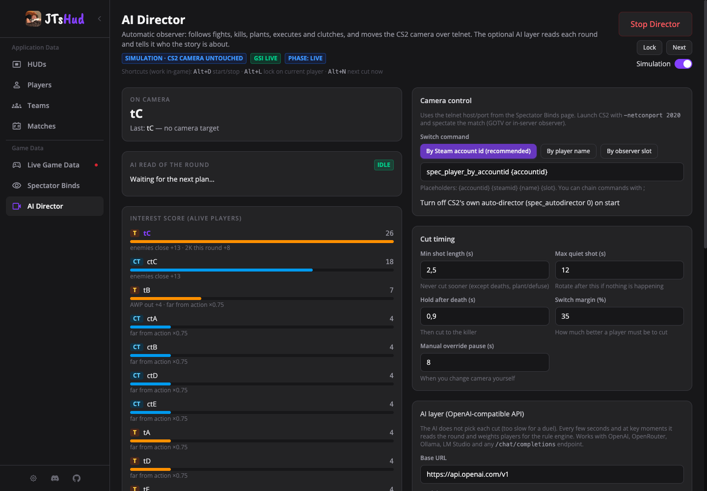
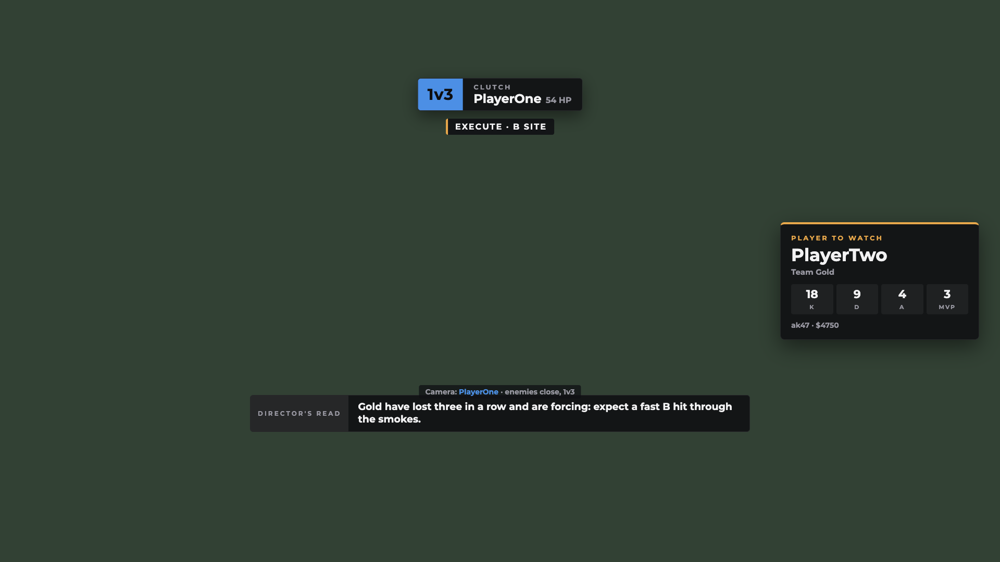

# JTs Hud · AI Director Edition

A Counter-Strike 2 custom HUD and HUD manager (players, teams, matches, overlays) **plus an AI Director addon**: an automatic observer that moves the CS2 spectator camera like a professional broadcast observer, so a match can be produced without anyone on the observer seat.

> **This is a community fork** of [JohnTimmermann/JTs-Hud](https://github.com/JohnTimmermann/JTs-Hud) (formerly OpenHud), maintained by **xfiveclub**. All the original HUD manager features are John Timmermann's work; this fork adds the [AI Director](#ai-director) and related changes listed in [Changes in this fork](#changes-in-this-fork). It is not the official release. Report issues with the AI Director here, and issues with the base HUD manager [upstream](https://github.com/JohnTimmermann/JTs-Hud/issues).

- Tech: Electron, Vue, Typescript, NodeJS/Express, Socketio, SQLite3
- License: [GPL-3.0](LICENSE), same as upstream

_Disclaimer from the original author: A small portion of this is ai generated, and while I don't entirely love the idea of vibe coding, it helped in areas that I struggled to understand. I have tried to comment the places that were generated and that could lead to some bugs._ The AI Director addon was also written with AI assistance and is covered by unit and end-to-end tests.

## Have questions about the base HUD manager? Join the original community [Discord](https://discord.gg/HApB9HyaWM)!


---

## What's new in this fork

**AI Director** — automatic observer for CS2 broadcasts:

- 🎥 **Moves the camera for you** over telnet: follows fights, cuts to the killer, jumps to plants/defuses, stays on clutches, and never cuts away mid-duel.
- 🧠 **Optional AI layer** with any OpenAI-compatible API (OpenAI, OpenRouter, Ollama, LM Studio...): reads each round and decides who the story is about.
- 📺 **Broadcast overlay** for OBS/vMix: "player to watch" card, clutch banner, execute alert and the AI's read of the round.
- ⏪ **Record & replay GSI** to tune the director (or test HUDs) without the game running.
- 🗺️ **Map zones** (callouts), **utility execute detection** and **look-ahead** anticipation for delayed GOTV broadcasts.
- ⌨️ **Operator shortcuts**: start/stop, lock on a player, force the next cut, plus automatic back-off when you take the camera yourself.



---

## Features

- **Built-in default HUD**
- **Bring Your Own HUD (BYOH)** - import any HUD compatible with the [cs2-react-hud](https://github.com/lexogrine/cs2-react-hud)
- **Player & team management**
- **Match management**
- **Keybinds**
- **Live view** - see the current CS2 game states and manage players mid-match
- **Spectator Binds tool** - Visually reorder and rebind observer slots, helps when hiding coaches from the overlay
- **AI Director** - automatic observer that moves the CS2 camera like a pro observer, with an optional AI layer (any OpenAI-compatible API) and a broadcast overlay

---

## Installation

1. Download the latest unpacked version or `.exe` installer from this repository's [Releases](../../releases/latest) page.

_Note: While the releases are for windows, electron builder does allow for linux and mac if needed_

### Building from source

Requires Node.js 22+.

```bash
git clone https://github.com/xfiveclub/JTs-Hud.git
cd JTs-Hud
npm install          # also downloads Electron and rebuilds sqlite3 for it
npm run dev          # run the app in development mode
npm run build:win    # or build:mac / build:linux / build:unpack
```

---

## CS2 Game State Integration Setup

The hud manager reads live data from CS2 via the Game State Integration (GSI) cfg. The config file can be installed automatically via the settings menu.

1. Click the **Settings** icon in the sidebar.
2. Select your **Steam directory** (the folder where Steam is installed, e.g. `C:\Program Files (x86)\Steam`).
3. Click **Install GSI**.

The hud manager will write the required config file into your CS2 installation automatically. Restart CS2 if it was already running, and the **Live** view will begin receiving game state data.


---

## Using the HUD

### Launching the default HUD

1. Open the **HUDs** tab.
2. Find **JTs Hud** and click **Launch**. This launches the main/default variant of the HUD
3. Press **Copy URL** button to copy the overlay URL and paste it into your broadcasting software (OBS, vMix, etc.) as a **Browser Source**.


### HUD variants

The default HUD ships with multiple layout variants (e.g. `default`, `horizontal`, `vertical`). Expand the HUD card to see all available variants and launch the one that fits your production layout.


### Panel controls

Click **Panel** on any HUD to open the live settings panel. In the default hud's panel you can **change team colors** along with other visual options shown in the image below


---

## Keybinds

### Global App Shortcuts

These shortcuts are always active while the hud manager is running, regardless of which HUD is open.

| Shortcut | Action                                                            |
| -------- | ----------------------------------------------------------------- |
| `Alt+F`  | Force-refresh all connected HUD overlays                          |
| `Alt+R`  | Toggle reverse sides for the current map in the active match veto |
| `Alt+D`  | Start / stop the AI Director                                      |
| `Alt+L`  | AI Director: lock the camera on the current player (toggle)       |
| `Alt+N`  | AI Director: cut to the next best player now                      |

### Default HUD Keybinds

When **JTs Hud** overlay is open, the following additional shortcuts become active:

| Shortcut | Action                |
| -------- | --------------------- |
| `Alt+V`  | Increase radar size   |
| `Alt+B`  | Decrease radar size   |
| `Alt+O`  | Toggle Hud visibility |

These are registered automatically when the overlay launches and unregistered when it closes.

---

## Bring Your Own HUD

This hud managers supports any HUD built against the [lexogrine/cs2-react-hud](https://github.com/lexogrine/cs2-react-hud) open-source template. The majority of features from the template spec are integrated, including game state data, player/team enrichment, match data, and panel controls.

**_Signed custom huds are now supported to protect hud makers but could be buggy_**

> **Not currently supported:** Lexogrine-specific features including ScoutAI, camera controls, and killfeeds (some in the works) are not available.

### Importing a custom HUD

1. Package your HUD as a `.zip` file. The zip should contain the HUD files at its root (including a `hud.json` manifest).
2. Open the **HUDs** tab and click **Import HUD**.
3. Select your `.zip` — the HUD will be extracted and appear in the list.
4. Signed huds should attach a **Verified** badge to itself in the HUDs card.

---

## Managing Players, Teams & Matches

### Players

Go to **Players** to create and edit player profiles. Each player can have:

- First name, last name, username
- Steam ID (used to match live GSI data to your player profiles)
- Country, avatar image
- Team assignment
- Coach flag

You can also bulk-import player rosters from an Excel spreadsheet using the import feature on the Players page.


### Teams

Go to **Teams** to create teams with a name, short name, logo, and country.


### Matches

Go to **Matches** to create a match:

1. Assign a left team and right team.
2. Add veto data (map picks/bans and side selections).
3. Set the match as **Current Match** in the form or matches action column in the table.


---

### Live View

The **Live** tab shows the current CS2 game state in real time. When a match is running, all 10 players are displayed with their live stats. This makes it easy to quickly create players on the fly and assign them to a team without leaving the view. **I highly recommend downloading a teams demo, playing the demo, and using this menu to create players and teams** as steamids and alias will be automatically filled in.

1. Open the **Live** tab while in a demo/server.
2. Click **Add Player** next to any live player to pre-fill their profile from GSI data (username, Steam ID).
3. Assign them to a team directly from the creation form.


---

## Spectator Binds Tool

The **Spectator Binds** tool lets observers assign specific players to fixed observer slots (1–10) and push those binds directly to CS2 via its telnet interface.

**Why use it?**
This tool is very useful for two cases.

### Coaches & Observer Slot Corruption

Platforms like Faceit have to get creative when allowing coaches into a server along with their players as Valve has yet to integrate a coaching slot like we had in CSGO. They do it by allowing the coach to join the team in game and killing them at the start of every round. This sucks for us as this means coaches take up extra observer slots which leads to players having slots 11, 12, etc.

### Lans and Obervers

Normally, CS2 will swap sides of teams at half which includes what slots each player is. LANs do not have the ability to switch which side the players are on while on the stage, so we can manually keep teams on the left and right with this. An additional benifit is that it helps observers as the slots will not change so players keep the same slot throughout the entire match.

**I solved this in two ways:**

- **Mark a player as a coach**: Go to **Players**, edit the player, and enable the **Coach** flag. This filters them out from the data sent to the overlays, essentially hiding them.

- **Override slots manually**: Use the Spectator Binds tool to visually override each player to a specific observer slot, and use binds to swap to the correct slots.

This is a **VISUSAL** change, we are not actually modifying the game in anyway other than using binds.

### Setup

1. Launch CS2 with telnet enabled. Add the following to your CS2 launch options:
   ```
   -netconport 2020
   ```
2. Open **Spectator Binds** in the program and click the **Telnet** settings button.
3. Enter the host (`127.0.0.1`) and port (`2020`) and save.
4. Click **Test Connection** to verify.

### Using Spectator Binds

1. Click **Fill from CS2** to populate slots from the current live game state.
2. Drag players between slots or use **Quick Assign** to assign an entire side at once.
3. Click **Apply Binds**: The hud manager sends the `bind` commands to CS2 via telnet automatically.
4. Use **Clear Binds** to remove all slot assignments.

> The **Command Preview** panel shows exactly what commands will be sent before you apply.

> **Names starting with a number** can't be targeted by `spec_player`. Enable **Bind by Steam account id** (below the pre-bind command) to bind with `spec_player_by_accountid` instead. If the camera doesn't move after applying, your CS2 build doesn't support it: turn the option off.


---

## AI Director

An automatic observer. It reads the live GSI data, decides who the camera should follow and moves the CS2 spectator camera over telnet (`-netconport`).

```
            GSI                                   telnet (-netconport)
  CS2  ───────────────►  JTs Hud  ─────────────────────────────────────►  CS2 camera
(observer)            AI Director  ──► HUD + Director overlay (OBS)
                           │
                           └── every few seconds (optional) ──► LLM: "who is this round about?"
```

### Quick start

1. Install the GSI cfg as usual (see [CS2 Game State Integration Setup](#cs2-game-state-integration-setup)).
2. Add `-netconport 2020` to the CS2 launch options (same as Spectator Binds) and **spectate** the match (GOTV or in-server observer).
3. Open **AI Director** in the sidebar and press **Start Director** (or `Alt+D`).
4. If the camera doesn't move, try another **Switch command** preset: _By Steam account id_ → _By player name_ → _By observer slot_. The page shows a warning when CS2 doesn't follow a command.

### How it decides

**Rule engine (real time, no AI needed).** On every GSI update each alive player gets an interest score. The page shows every score and why.

| Signal                                       | Weight       |
| -------------------------------------------- | ------------ |
| Taking or dealing damage (a real fight)      | very high    |
| Defusing / planting                          | +70 / +60    |
| Clutch (1vX)                                 | +30 and up   |
| Enemies close and looking at each other      | up to +44    |
| Just got a kill                              | up to +25    |
| In the area of a utility execute             | up to +22    |
| AWP out, carrying the bomb, multi-kill round | small bonus  |
| Far from the action, flashed                 | ×0.75 / ×0.6 |
| AI layer weights                             | ×0.5 – ×2    |

Cuts follow broadcast rules:

- a shot lasts at least **2.5 s**, unless the player dies or a plant/defuse starts elsewhere;
- **never cut away from a player who is in a fight**;
- when the player on camera dies, hold ~0.9 s, then **cut to the killer**;
- a new player must be clearly more interesting (**+35%**) for a moment before switching, so the camera never flickers;
- rotate after 12 s on a quiet shot; during freezetime show the AI's pick or the top fragger.

All timings are configurable on the AI Director page.

**AI layer (optional).** At freezetime, every ~10 s and on key moments (plant, execute, clutch) an LLM receives a compact summary of the round (score, economy, weapons, who is grouped with whom and where, recent events) and returns per-player weights, a team focus and a one-line storyline. It **never picks individual cuts**: a model call takes 0.5–3 s and a duel is over before that. If the AI is slow or fails, the rule engine keeps working.

| Provider          | Base URL                       | Notes                                                   |
| ----------------- | ------------------------------ | ------------------------------------------------------- |
| OpenAI            | `https://api.openai.com/v1`    | Use a fast/small model: latency matters more than depth |
| OpenRouter        | `https://openrouter.ai/api/v1` | Any model they host                                     |
| Ollama (local)    | `http://localhost:11434/v1`    | No API key needed                                       |
| LM Studio (local) | `http://localhost:1234/v1`     | No API key needed                                       |

The client adapts automatically to endpoints that reject `max_tokens`, `temperature` or `response_format`.

> **Privacy:** when the AI layer is on, the round summary (player and team names, stats, money, weapons, zones and recent events) is sent to the provider you configure. Use a local model if that is a concern. The API key is stored encrypted with the OS keychain, only travels over Electron IPC (never the local HTTP API) and is only sent to the base URL you set.

**Operator control.**

| Shortcut | Action                                                         |
| -------- | -------------------------------------------------------------- |
| `Alt+D`  | Start / stop the director                                      |
| `Alt+L`  | Lock the camera on the current player (released when they die) |
| `Alt+N`  | Cut to the next best player now                                |

If you change the camera yourself, the director detects it and backs off for 8 s. Switches CS2 makes on its own (deaths, round changes) don't count. Shortcuts work while CS2 has focus.

### Director overlay

A separate browser source to put **on top of the HUD** in OBS/vMix: `http://localhost:1349/overlays/director/` at 1920×1080. Every widget can be toggled from the AI Director page.



| Query param | Default             | Purpose                                                        |
| ----------- | ------------------- | -------------------------------------------------------------- |
| `preview=1` | —                   | Show sample widgets to position the source without a live game |
| `ct` / `t`  | `5d9cec` / `e8b04a` | Team colours (hex, without `#`)                                |
| `top`       | `150`               | Vertical offset of the clutch / execute banner (px)            |
| `bottom`    | `250`               | Offset of the storyline and camera tag from the bottom (px)    |
| `scale`     | `1`                 | Overall size                                                   |

### Record & replay

Press **● Record** to save the GSI of a match (or of a demo played in CS2), then replay it later at 0.5×–8× without the game. Replays go through the same pipeline as live data (HUD, Live view, director). By default the director runs in **simulation**, deciding cuts inside the app without touching the real CS2 camera, which makes replays the way to tune the director. Recordings are gzipped JSON Lines in the app's `gsi-recordings` folder.

### Map zones

No callouts ship by default. To add one, spectate a player standing on the spot (live or in a replay), pick them, type the name (e.g. _Banana_, _A site_) and save. The AI then reads "stack @ Banana" instead of coordinates, and executes are labelled with the zone ("Execute · B site"). Zones can be exported and imported as JSON to share them.

### Look-ahead (anticipation)

Professional observers watch through GOTV with `tv_delay`, so they know what is about to happen. To do the same:

1. Run a second CS2 client **without delay** (e.g. an in-server spectator, possibly on another PC).
2. On the AI Director page, enter this PC's address and **Copy look-ahead cfg**. Save it as `gamestate_integration_jts_lookahead.cfg` in that client's `csgo/cfg` folder.
3. Set **Broadcast tv_delay** to the server's `tv_delay`.

The director then sees fights before they air and moves the camera there ~1.5 s early.

### Known limitations

- Line of sight isn't part of GSI: "enemies close" is estimated from distance, height and view direction, so walls can fool it. Real damage always wins.
- `spec_player_by_accountid` may not exist on every CS2 build. Use the _player name_ preset if the camera doesn't follow.
- The scoring weights are a first calibration. Recordings of real matches are the best way to tune them; feedback and PRs are welcome.

---

## Local API security

Since this fork, the local server (port `1349`) and the GSI listener (`23415`) no longer accept requests from any website. Allowed are: the app itself (per-session token), pages served by the server itself (HUDs and overlays, also from another PC on the LAN), `localhost` on any port (HUD dev servers) and non-browser clients such as CS2. **If you host a custom HUD on another domain and call the API from it, it will now be rejected.**

---

## Development

```bash
npm run typecheck    # main + renderer
npm test             # unit tests (Vitest): director rules, AI client, GSI recorder, zones, origin guard
npm run test:e2e     # builds the app and runs the Electron smoke test (Playwright)
```

CI (`.github/workflows/ci.yml`) runs typecheck, unit tests, build and the end-to-end smoke test on every push and pull request.

Main code locations for the addon:

| Path                                          | What                                                     |
| --------------------------------------------- | -------------------------------------------------------- |
| `src/main/server/director/`                   | Rule engine, director, AI client, config, map zones, IPC |
| `src/main/server/integrations/netcon.ts`      | Shared telnet connection to CS2                          |
| `src/main/server/integrations/gsiRecorder.ts` | GSI recorder / replayer                                  |
| `src/main/server/middleware/originGuard.ts`   | Local API origin policy                                  |
| `resources/overlays/director/`                | Director overlay (browser source)                        |
| `src/renderer/src/views/DirectorView.vue`     | AI Director page                                         |

---

## Data & Storage

All data (players, teams, matches, HUD files) is stored locally on your machine. which can be found at: `C:\Users\USER\AppData\Roaming\jts-hud-manager\`

The huds directory would be at: `C:\Users\jtmyt\jthm-huds`

---

## Changes in this fork

Modified by xfiveclub, November 2026, relative to [JohnTimmermann/JTs-Hud](https://github.com/JohnTimmermann/JTs-Hud) v7.13.26:

- **Added** the AI Director: rule engine, optional LLM layer, director overlay, GSI record & replay, map zones, utility execute detection, look-ahead feed (`/cs2/lookahead`) and operator shortcuts (`Alt+D`, `Alt+L`, `Alt+N`).
- **Added** an option in Spectator Binds to bind by Steam account id, which works for player names that start with a number.
- **Changed** Spectator Binds and the director to share a single persistent telnet connection.
- **Changed** the local servers from allowing any origin (CORS `*`) to an origin policy (see [Local API security](#local-api-security)).
- **Changed** the update check and GitHub links from the old `JTs-Hud-Manager` name to `JTs-Hud`.
- **Added** unit tests (Vitest), an Electron end-to-end smoke test (Playwright) and CI.

## License

GPL-3.0, see [LICENSE](LICENSE). Original work © John Timmermann and contributors; AI Director addon © xfiveclub and contributors. Both are distributed under the same license.
